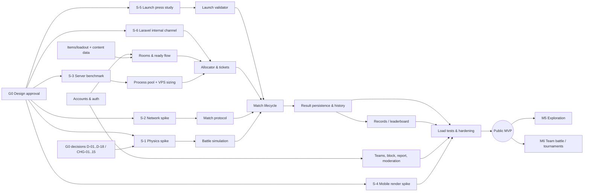

# Milestone Roadmap & Dependency Map

| Document ID | DOC-PLN-001 | Status | [P] — durations intentionally omitted until team size/budget are known |
|---|---|---|---|

## 1. Milestones
| ID | Milestone | Content | Exit gate |
|---|---|---|---|
| M0 | **Design package** (this) | Requirements, UML, ERD, API, ADRs | **G0: user approves design + answers blocking questions** |
| M1 | Technical spikes (throw-away, after G0) | S-1 physics + combat feel (custom top model, advantage S, burst gauge, triangle emergence with bots); S-2 ENet snapshots + **joystick prediction** under impairment; S-3 headless process RAM/CPU benchmark; S-4 mobile rendering; **S-5 launch press study** (press distributions per device, cap, curve); S-6 Laravel heartbeat-pull + Reverb push latency | G1: ADR-005/006/007/012–015 accepted with evidence |
| M2 | Battle MVP | E-mail accounts, unique names, parts & builds with stat preview, rooms by code, allocation/tickets, launch window, joystick, skills, combat + burst, FFA, spectators, results & history, version gate, logging, balance telemetry | G2: internal alpha playable on Windows, Android, Linux |
| M3 | Social MVP | Profiles polish, record/leaderboard, block/report, moderation tool, basic teams | G3: closed beta |
| M4 | Hardening | Load tests L-100/M-20, backups/restore, monitoring, privacy, store submissions | G4: MVP readiness criteria met → public MVP |
| M5 | Exploration vertical slice | Small bounded world, chest interaction, challenge/accept, arena transition | User approval of loot rules first |
| M6 | Competitive expansion | Team Battle rules, organizer workflow, tournaments, rated ranking (ADR-009 D), macOS/iOS release, opposite-spin mechanics, more skills | Rules approved |
| M7 | Future | Proximity voice, voice commands, virtual-item stakes (only if approved), seasons, regions | Separate design + approval |

## 2. Dependency map

