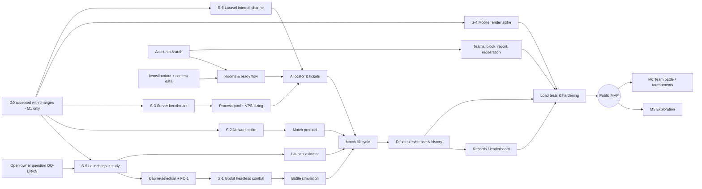

# Milestone Roadmap & Dependency Map

| Document ID | DOC-PLN-001 | Version 0.4.1 | Status: G0 decisions recorded (owner-confirmed D-01…D-03, delegated D-04…D-18; owner decisions OQ-LN-08, OQ-CB-12); **G0 accepted with changes by the owner on 2026-11-22 — M1 authorised, not started**. Durations omitted until team size/budget are known. |
|---|---|---|---|

## 1. Milestones
| ID | Milestone | Content | Exit gate |
|---|---|---|---|
| M0 | **Design package** (this) — v0.4.1 | Requirements, UML, ERD, API, ADRs, G0 decisions integrated | **G0: accepted with changes, M1 only** (owner, 2026-11-22; `../09-review/G0-approval-review.md`); open owner question OQ-LN-09 |
| M1 | Technical spikes (throw-away; authorised only by G0) — **executable checklist: `M1-spike-checklist.md`** | S-5 launch input study (first: cap, FC-1, accessibility); S-1 Godot headless combat with spin as scalar up to 350 RPS, burst boundaries, 1-v-1 + FFA bots, real skills; S-2 netcode + prediction; S-3 server resources; S-4 mobile rendering incl. visual spin; S-6 Laravel 13/Reverb/Godot integration | G1: AC-1…AC-9 evaluated; ADR-005/006/007/012–015 evidence; ranked gate re-assessed |
| M2 | Battle MVP | E-mail accounts, unique names, parts & builds with stat preview, rooms by code, allocation/tickets, launch window, joystick, skills, combat + burst, FFA, spectators, results & history, version gate, logging, balance telemetry | G2: internal alpha playable on Windows, Android, Linux |
| M3 | Social MVP | Profiles polish, record/leaderboard, block/report, moderation tool, basic teams | G3: closed beta |
| M4 | Hardening | Load tests L-100/M-20, backups/restore, monitoring, privacy, store submissions | G4: MVP readiness criteria met → public MVP |
| M5 | Exploration vertical slice | Small bounded world, chest interaction, challenge/accept, arena transition | User approval of loot rules first |
| M6 | Competitive expansion | Team Battle rules, organizer workflow, tournaments, rated ranking (ADR-009 D), macOS/iOS release, opposite-spin mechanics, more skills | Rules approved |
| M7 | Future | Proximity voice, voice commands, virtual-item stakes (only if approved), seasons, regions | Separate design + approval |

## 2. Dependency map

